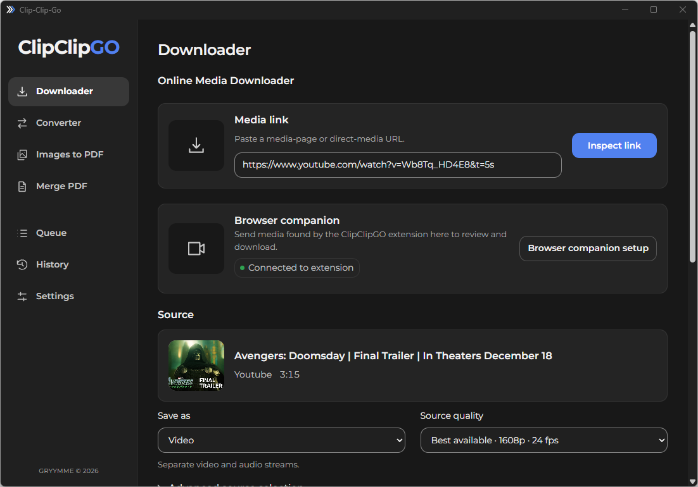
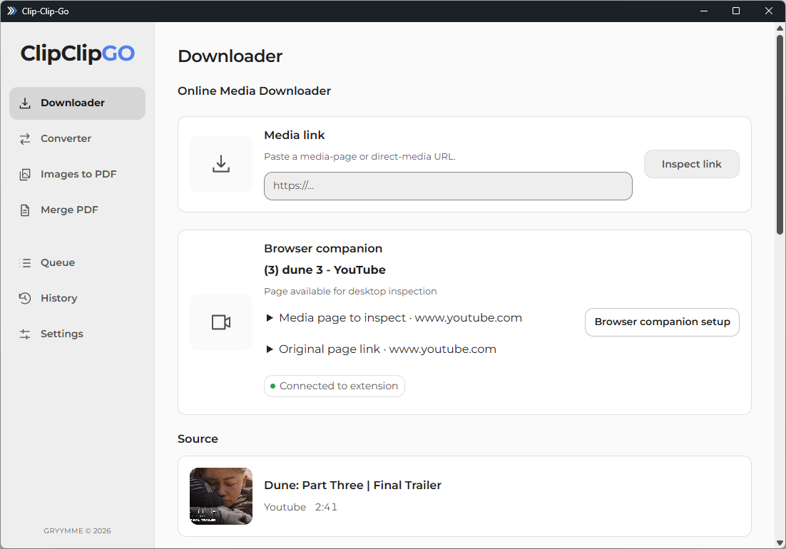
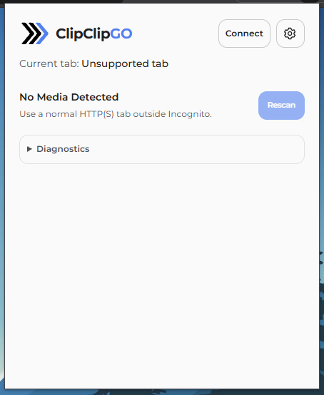
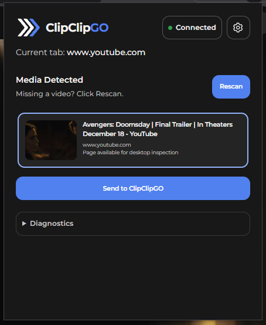
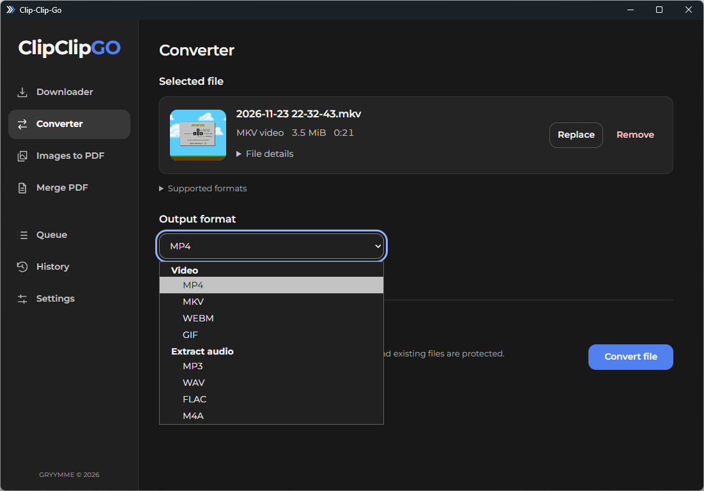
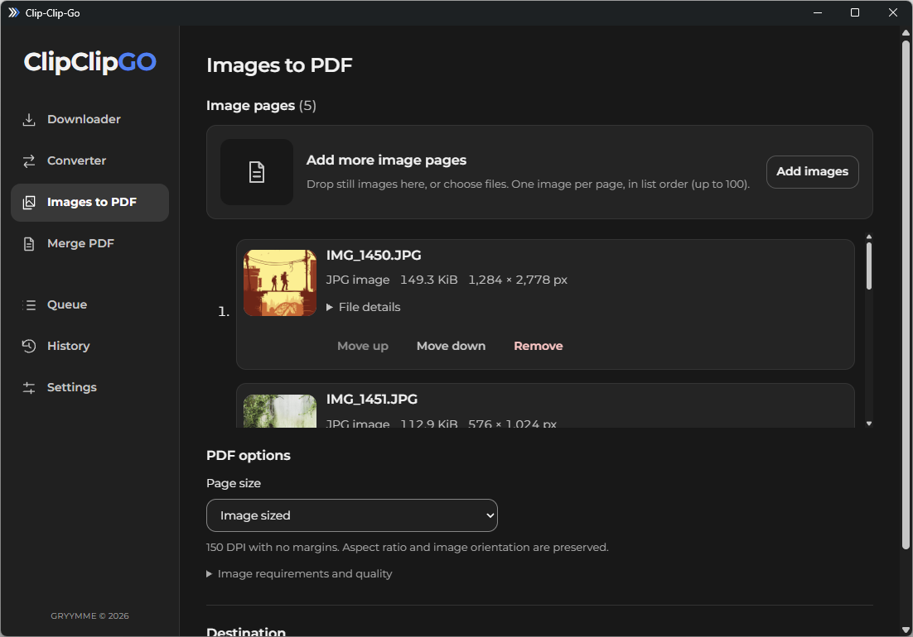
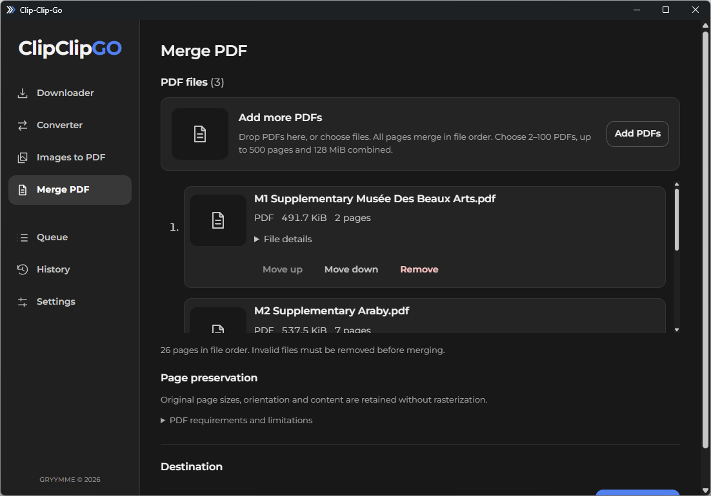
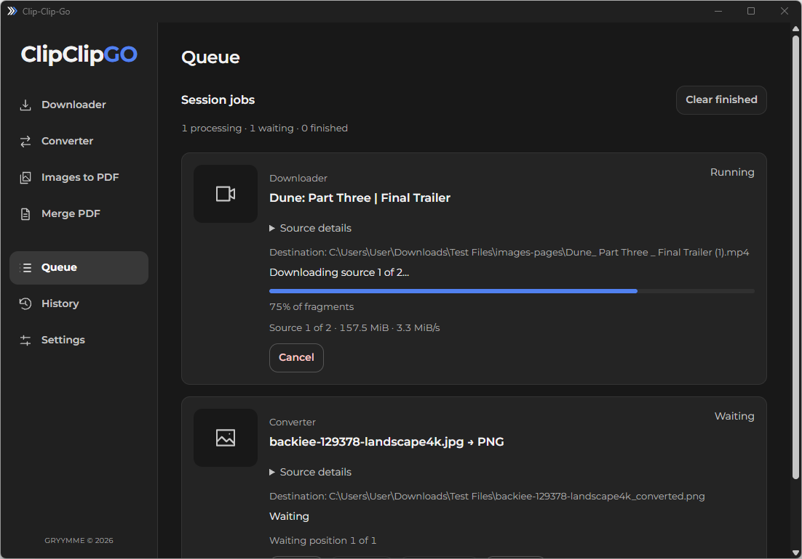
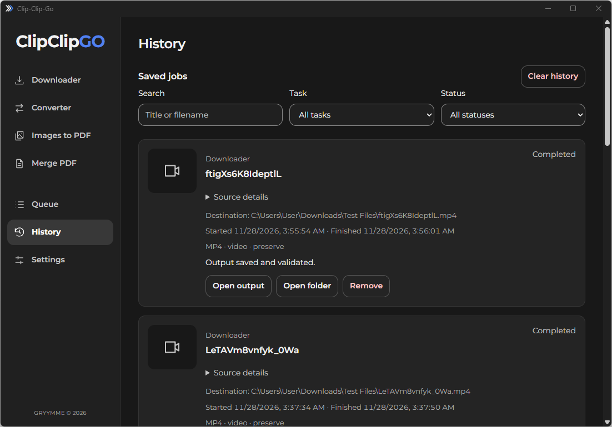

# Clip-Clip-Go

**ClipClipGO** is a Windows desktop app for single-link media downloads and local file conversion. A session Queue runs output jobs one at a time; optional History records finished attempts on this computer.

## Downloader

Paste a media-page or direct HTTP(S) media URL, choose **Inspect link**, then select the source quality and output settings. Choose **Download** (or **Add to queue**) to open the native Save dialog for both location and filename. The suggested name comes from the title; the selected output format determines the extension, including when another extension is typed. Cancelling the dialog preserves the current setup. Existing files are never overwritten.



| Output | Options |
| --- | --- |
| Video | MP4, MKV, WebM; compatible available H.264, HEVC, VP9 and AV1 encoders |
| Resolution / frame rate | Original or applicable smaller resolutions through 2160p; original or 24/25/30/50/60 fps |
| Quality | Preserve compatible streams, quality presets, or a separate custom target-bitrate mode |
| Audio | Keep/remove video audio; MP3, M4A, WAV, FLAC, OGG or Opus audio output |
| Advanced audio | Compatible codec, bitrate, sample rate and channel settings; bitrate hidden for lossless/PCM |

Separate video/audio streams are merged. Compatible streams are copied/remuxed; only streams requiring changes are re-encoded. Missing source details remain unknown and downloaded streams are checked before publication. There is no resolution upscaling or frame interpolation; increasing frame rate duplicates frames, and higher bitrate/lossless output cannot recover missing detail. Source sizes may be estimates.

Inspection is cancellable and time-limited. Downloads report measured stages/progress, support cancellation across navigation, stage work in owned temporary directories, and validate output with FFprobe before protected publication. The queued job retains its selected source, settings, name and destination.

Site support depends on yt-dlp and source availability. Playlists, live streams, login/cookie importing, DRM/access-control bypass and automatic engine updates are unsupported. Some sites require credentials or expire URLs; detection does not guarantee downloading. See [Downloader implementation and verification limits](docs/downloader.md).

### Chrome browser companion

The optional companion sends discovered media or a supported media page to Downloader. Direct files/manifests are inspected as resources; extractor-backed page candidates remain distinguished from confirmed media. Sending does not start a download: review the source/output settings and confirm in ClipClipGO.



| Ready to connect | Media page found |
| --- | --- |
|  |  |

Set up through **Settings → Extension Installation Guide** or Downloader's **Browser companion setup**:

1. Open `chrome://extensions/` and enable **Developer mode**.
2. Choose **Load unpacked** and select the app's `extension` folder. The guide provides **Open extension folder** and **Copy folder path**, resolving the actual installation location or an identified development fallback.
3. Paste the ID displayed by Chrome into ClipClipGO and choose **Connect / Finish setup**. Open the extension popup and click **Connect**. A real handshake confirms connection; a saved ID does not.

No PowerShell registration is needed. No official store listing is currently configured. Production store installation, if distributed later, would not require Developer mode.

Use **Allow** to grant site access explicitly. Detection runs across permitted tabs/navigation until access is revoked; candidates remain temporary and expire independently. Settings provides actual grant review/revocation, additional origin access, diagnostics, clear-data and an extension-only theme preference. Page discovery can identify resource URLs without granting their CDN access; observing CDN requests or loading restricted thumbnails may need a separate explicit grant. Static thumbnails use associated posters, readable bounded video-frame snapshots, then an icon.

No browser cookies, Authorization headers, passwords, response bodies or browsing history are collected. Media URLs/context remain session-scoped. Remove the extension through Chrome's Extensions page; bridge resources remain app-owned and can be removed through ClipClipGO maintenance. Removing the extension does not delete downloads or desktop History. See [setup, permissions and removal](docs/browser-companion.md).

## Converter

Choose/drop one file, select an output, then choose its destination and filename in the native Save dialog.



| Input | Outputs |
| --- | --- |
| MP4, MKV, WebM, MOV | MP4, MKV, WebM, GIF; extract MP3, WAV, FLAC, M4A audio |
| MP3, WAV, FLAC, M4A | MP3, WAV, FLAC, M4A |
| JPG/JPEG, PNG, WebP, BMP, TIF/TIFF, HEIC | JPG, PNG, WebP, BMP, TIFF |
| TXT, Markdown, HTML | TXT, Markdown, HTML, PDF |
| PDF | TXT, Markdown, HTML, PNG, JPG |

Audio extraction requires an audio stream. GIF has no audio and can become large for long/high-resolution clips. Still-image conversion applies orientation and preserves oriented dimensions; JPEG flattens transparency onto white. Metadata/ICC preservation and color management are not provided. Animated/multipage still-image inputs are rejected. HEIC is input-only: primary 8-bit SDR HEVC still images are supported; HDR/wide-gamut, ICC, alpha/gain maps and sequences are unsupported. See [HEIC scope and notices](third-party/heic/NOTICE.md).

Document conversion excludes Microsoft Office/OpenDocument formats. HTML is inert: no JavaScript execution or remote-resource fetching. Generated PDFs reflow supported content with an embedded Noto Sans font; they do not reproduce HTML/CSS page designs. Generation supports tested Latin/diacritics, Greek and Cyrillic; unsupported glyphs fail explicitly.

PDF text output is **reconstructed content**: original styling, exact tables and perfect reading order are not preserved. OCR and password-protected PDFs are unsupported. PDF-to-image output uses 150 DPI and an optional page range; enter a **new output folder name** in the Save dialog for ordered page files. See [text/PDF formats, safety limits and font coverage](docs/text-pdf.md).

## Images to PDF

Add 1–100 still images, reorder them, and choose A4, Letter, Legal, Custom or Image sized. Image sized is the default and uses oriented pixels at 150 DPI without margins. Fixed/custom pages fit inside half-inch margins; Custom supports inches, centimeters or pixels with DPI. Changing units/DPI preserves physical dimensions. Each custom side must exceed 1 inch (2.54 cm) and be at most 200 inches (508 cm); DPI must be 1–2400.



Images are flattened onto white and embedded as JPEG quality 90; output is not claimed lossless. Limits include 100 million combined decoded pixels, with per-image limits of 16 million pixels, 16,384 pixels per side and 128 MiB input/decoded data.

## Merge PDF

Add 2–100 PDFs, arrange their order and save a new document. Complete pages are imported without rasterizing or reconstructing text; page dimensions/rotation are retained. Limits are 128 MiB combined input, 128 MiB output and 500 combined pages.



Encrypted or invalid files block merging rather than being skipped. Complex/internal links, forms, bookmarks, attachments, layers, accessibility tags and metadata are not guaranteed to survive. Digital signatures must not be treated as valid after merging. Review important documents in a PDF viewer; merging is not an active-content sanitizer.

## Queue and History

Queue captures each submitted configuration, processes one job at a time and supports cancellation/removal. Waiting and finished session entries are not restored after restart; there is no automatic retry or pause/resume. Normal cancellation/exit cleans owned temporary work; crashes can leave staging directories. Protected Downloader publication requires a filesystem supporting hard links and fails explicitly otherwise.



History stores the newest 500 finished attempts locally, with search, task/status filters and output actions. **Save job history** in Settings switches future recording on/off. Switching it off preserves existing History and does not affect Queue. Removing records does not delete output files. Full media URLs and credentials are excluded, but filenames/paths can still be sensitive.



## Bundled components and development

Users install no conversion tools, choose no engine folders and receive no first-launch engine downloads. Bundled engines are **FFmpeg/FFprobe 9.0.2 essentials**, **yt-dlp 2026.10.26** (with embedded EJS scripts), **Deno 2.9.8**, and application-local **PDFium** with V8/XFA disabled. Conventional image/text libraries are compiled into the app. Missing/damaged assets produce a repair message; there is no PATH/system-tool fallback.

The local Tauri 2 CLI, React, TypeScript, Vite and plain CSS foundation requires Windows x64, Node/npm, Rust MSVC, C++ build tools/Windows SDK and WebView2. npm/Cargo lockfiles are retained. On a fresh checkout use `npm ci`.

Desktop launch (native dialogs/conversion):

```sh
npm run tauri dev
```

Frontend preview only (no native dialogs/conversion):

```sh
npm run dev
```

Desktop development/build hooks run `engines:prepare`, `downloader:prepare`, `pdf:prepare` and `companion:build` before the frontend. Pinned URLs, SHA-256 hashes, versions and build flags are in `scripts/ffmpeg-manifest.json`, `scripts/downloader-manifest.json` and `scripts/pdf-manifest.json`. Verified project-local caches are reused; downloads/extraction happen only during developer setup/build. No global installation or PATH changes occur. `npm run pdf:prepare` can be run separately; `npm run pdf:verify-resources` checks the compiled debug payload. Preserve tracked manifests, preparation scripts and notices.

Build a Windows debug application without an installer:

```sh
npm run tauri -- build --debug --no-bundle
```

The executable is `src-tauri/target/debug/clip-clip-go.exe`. Retain its accompanying `ffmpeg.exe`, `ffprobe.exe`, `yt-dlp.exe`, `deno.exe`, `pdf/`, `notices/`, native host and `extension/` resources. Copying the executable alone is insufficient; no portable ZIP is provided. Building does not verify installation or native dialogs.

Notices are in `third-party/ffmpeg`, `third-party/downloader`, `third-party/text`, `third-party/pdf` and `third-party/heic`, packaged under `notices/`. Bundled Montserrat/Noto Sans fonts retain their OFL licenses, alongside engine/dependency notices. The application license is unchanged. **FFmpeg public redistribution and complete-corresponding-source obligations remain open** as documented in [its notice](third-party/ffmpeg/NOTICE.md); attribution alone is insufficient. No patent clearance is claimed.

## Verification

Use `npm run typecheck`, `npm run build` and focused tests appropriate to the change; `npm test` runs the frontend suite. Rust checks use `cargo check --manifest-path src-tauri/Cargo.toml` and targeted `cargo test` filters. `npm run engines:verify`, `npm run downloader:verify` and `npm run pdf:verify-resources` check prepared resources. This checkout's cached Rust checks use PowerShell `$env:CARGO_HOME="$PWD/.cargo-cache"` and `$env:CARGO_NET_OFFLINE="true"`.

Local fixtures/SSR tests do not prove public-site compatibility, rendered desktop appearance or native-dialog behavior. Browser permissions/playback, native selection/save dialogs and installed-app behavior require manual testing. Native drag/drop uses Tauri webview events and actual OS paths; detach developer tools when manually checking drop coordinates.
